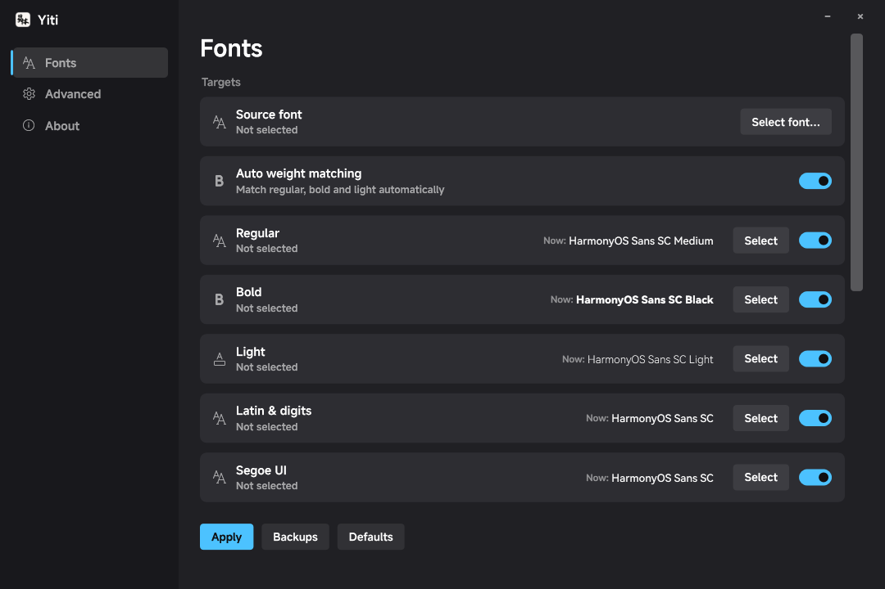
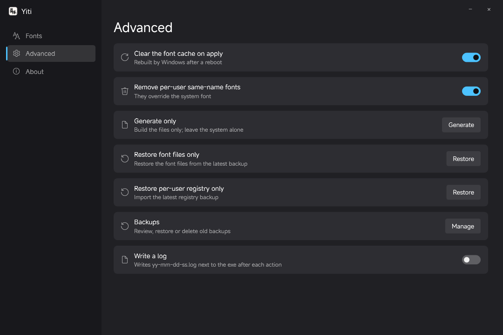
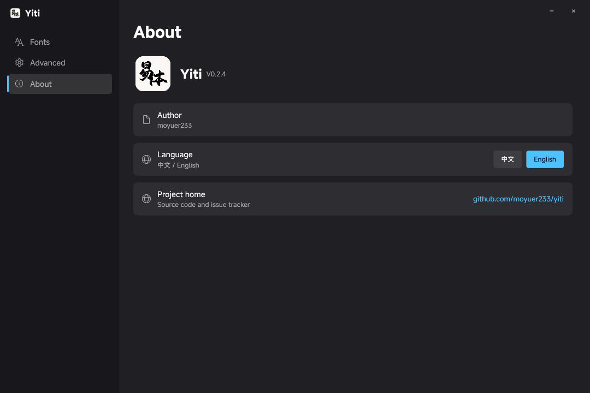

<p align="center">
  <a href="https://github.com/moyuer233/yiti"></a>
</p>

<div align="center">

# Yiti (易体)

_✨ The no-brainer system-wide font replacement tool for Windows ✨_

<a href="README.md">中文</a> | <a href="README.en.md">English</a>

</div>

<p align="center">
  <a href="https://github.com/moyuer233/yiti/blob/main/LICENSE"></a>
  <a href="https://github.com/moyuer233/yiti/releases"></a>
  <a href="https://github.com/moyuer233/yiti/releases"></a>
  <a href="https://github.com/moyuer233/yiti/commits/main"></a>
  <a href="https://github.com/moyuer233/yiti/commits/main"></a>
</p>
<p align="center">
  <a href="https://www.microsoft.com/windows"></a>
  <a href="https://dotnet.microsoft.com"></a>
  <a href="https://github.com/moyuer233/yiti"></a>
</p>

<details>
<summary><h3>Screenshots (click to expand)</h3></summary>







</details>

## Features

- **System font replacement**: fonts inside Settings, the Start menu, the taskbar, title bars and other apps
- **Shell element font replacement**: small caption, menu, message box, status bar, icon
- **Automatic weight matching**: pick one font and the weights are matched at 400 / 700 / 300, for example Microsoft YaHei Regular / Bold / Light are replaced together; picking a font per slot is supported too
- **Automatic backup and rollback**: Restore rolls everything back in one click; the Default preset reads from `C:\Windows\WinSxS` first, so it still works when the backup is gone
- **Adapts to the OS version**: fonts the system does not have (Windows 7 has no Light weight and no Segoe UI Variable) are disabled automatically
- **Creates a system restore point before applying**: taken right before anything is written; if it cannot be created the status bar says why (it does not block the swap)
- **Half-replaced detection**: on launch it verifies that all five files were really replaced; if only part of them changed, the font page shows a banner with a one-click **Re-apply**
- **Backup manager**: lists every backup taken before a swap (date, size, files inside), supports multi-select delete and rolling back to any of them; you can turn auto-backup on/off, cap how many are kept, and see/clear the staging folder usage; hovering a backup shows which fonts it wrote and how many are still in use; the same window can import the per-user registry backup (HKCU-Fonts*.reg)
- **Missing files can be restored**: if one of the system font files is gone at startup (for example a queued rename was interrupted), the font page shows a banner with a one-click **Restore from backup**

## How it differs from noMeiryoUI

[noMeiryoUI](https://github.com/Tatsu-syo/noMeiryoUI) changes the "UI font setting" (the registry key `HKCU\Control Panel`), so it cannot touch the taskbar, preinstalled apps (Settings, Paint), programs that ignore the system font, or the Windows 11 title bar font.

Yiti replaces **the system font files themselves**, so all of those change. Two core differences:

| | Yiti | noMeiryoUI |
|---|---|---|
| How it works | Replaces the system font files (the three YaHei files + Segoe UI) | Changes the UI font setting |
| Settings, Start menu, taskbar, title bars | ✅ all change | ❌ not supported |
| Rollback | Automatic backup + one-click rollback; even without a backup the originals can be taken from the component store | You have to export the registry yourself |

What stays the same: font rendering clarity (ClearType), apps that ship their own fonts (Office, Electron apps), and the fact that the first apply needs a reboot.

## Risks

This tool modifies **system font files**: a change that needs a reboot and is awkward to undo before that reboot. Known risks:

- **A wrong font can leave the UI with missing glyphs**: if the font lacks Chinese characters or a weight, menus and title bars show boxes or blurry text after the reboot; in bad cases some legacy programs render incorrectly.
- **Office / WPS layout and export change**: "Microsoft YaHei" in your documents is now your font, so exported images, printing and PDF conversion will differ from before.
- **Apps must be restarted**: the files are only swapped at boot; forcing a power-off in between can leave the swap incomplete and needs another reboot.
- **Antivirus may block or flag it**: it has to write into `C:\Windows\Fonts`, and some security software blocks or even flags that. When it is blocked the app reports an error; it does not fail silently.
- **System updates can overwrite it**: a Windows feature update resets the system fonts; apply again afterwards.
- **Rollback depends on the backup or the component store**: both are handled automatically, but if both have been cleaned you are left with a restore point or the installation media — **create a restore point yourself before the first run**.

## Font support by Windows version

| | Win7 | Win10 1809+ | Win11 22000+ |
|---|---|---|---|
| YaHei Regular / Bold | ✅ | ✅ | ✅ |
| YaHei Light (`msyhl.ttc`) | ❌ not shipped | ✅ | ✅ |
| Segoe UI Variable (`SegUIVar.ttf`) | ❌ not shipped | ✅ | ✅ |
| Removing per-user same-name fonts | ❌ no such mechanism | ✅ | ✅ |
| Taskbar / Settings and other new UI | partial (via `segoeui.ttf`) | ✅ | ✅ |
| Variable font (.ttf VF) as the source | ❌ only the default weight is drawn | ✅ | ✅ |

On older systems the font cache service is called `FontCache3.0.0.0`; from Windows 10 it is `FontCache`.

### Test progress

| System | Status | What was verified |
| --- | --- | --- |
| Windows 11 26200 | ✅ **Tested** | Replacing all five font files, automatic weight matching, shell elements (menu / message box / status bar / small caption / icon) applying immediately, Restore and Default preset, Chinese/English UI, backup and rollback |
| Windows 10 1809+ | ⚠️ **Should work, not tested** | Version detection is implemented (per-user fonts, `FontCache` service name, flat grey background when Mica is unavailable), but it has not been run on a real machine |
| Windows 7 / 8.1 | ⚠️ **Should work, not tested** | Missing fonts are greyed out with a reason; the `FontCache3.0.0.0` and no-Mica branches exist, but they have not been run on a real machine |

**Feedback wanted.** If you try it on Windows 7 / 8.1 / 10, please report the result either way in [Issues](https://github.com/moyuer233/yiti/issues); I will improve the app based on that feedback.

To send feedback, turn on **Advanced → Write a log** and then run one action (for example *Generate system font files*); a `yy-mm-dd-ss.log` appears next to the exe. Attaching that log is enough.

## Files replaced

| File | Font name | What it affects |
|---|---|---|
| `msyh.ttc` | Microsoft YaHei Regular | Chinese body text, Settings, Start menu, File Explorer |
| `msyhbd.ttc` | Microsoft YaHei Bold | everything bold in Chinese |
| `msyhl.ttc` | Microsoft YaHei Light | light weight (Windows 8 and newer) |
| `SegUIVar.ttf` | Segoe UI Variable | taskbar, top of Settings, Latin text and digits in the Windows 11 UI |
| `segoeui.ttf` | Segoe UI | classic English UI, legacy programs |

System font replacement flow: read the font you picked → rewrite only its internal names to `Microsoft YaHei` / `Segoe UI` and the like → build files with those names → replace the ones in the system → reboot. That is the only way Windows will recognise them.

Shell element replacement flow: write the registry key `HKCU\Control Panel\Desktop\WindowMetrics` to control the font and size of the legacy UI.

**What cannot be changed**: programs that ship their own fonts (Office, Electron apps, games), text that specifies a font inside a web page, and font rendering parameters (ClearType and friends).

### Why the internal names have to change

Windows **does not look at the file name when looking for a font; it looks at the font's internal `name` table** (the naming table in the OpenType spec). A font has more than twenty name fields, each with a number:

| ID | Meaning | What the system uses it for |
|---|---|---|
| 1 | Family | the words "Microsoft YaHei". The GDI LOGFONT and the font names hardcoded in WinUI themes all refer to it |
| 2 | Subfamily | Regular / Bold / Light |
| 4 | Full name | "Microsoft YaHei Bold" |
| 6 | PostScript name | Adobe-family software identifies the font by it |
| 16 / 17 | Typographic family / subfamily | modern DirectWrite prefers these two |
| 3 / 18 / 21 / 22 | Unique ID / WWS name | font cache and font pickers |

Yiti rewrites only those 10 fields (each record exists twice, once per platform encoding: Windows and Mac) and **does not touch a single byte of the `glyf` outlines, `hmtx` metrics, `cmap` character map or the `GSUB/GPOS` layout tables**. So after the swap:

- the name shown in the UI is still "Microsoft YaHei", but **every stroke comes from the font you picked**;
- the system looks fonts up by name, finds this renamed file, and Settings, the Start menu and the taskbar follow;
- copyright / version / trademark / designer (0, 5, 7, 9) are **deliberately left alone**: they keep the original author information, and they are exactly what lets the app work out which font is currently installed.

## How it works in detail

Three stages: build → replace → reboot to apply.

### 1. Build: turn your font into a look-alike

1. Read the source font (for a TTC, take one face by index), parse the table directory and keep TrueType outlines only (`glyf`); CFF/OTF is rejected outright.
2. Rebuild the `name` table: replace 1 (family), 2 (subfamily), 3/4 (full name), 6 (PostScript), 16/17 (typographic family/subfamily) and 18/21/22 (WWS) with Microsoft's names, and leave every other record (copyright 0, version 5, trademark 7, designer 9, …) untouched.
3. Pack per target:

| Target file | Family names written in (number of faces) |
|---|---|
| `msyh.ttc` | `Microsoft YaHei` + `Microsoft YaHei UI`, both Regular (a TTC with 2 faces) |
| `msyhbd.ttc` | same two families, Subfamily = **Bold**, PostScript name carrying `-Bold` |
| `msyhl.ttc` | `Microsoft YaHei Light` + `Microsoft YaHei UI Light` (typographic family stays YaHei, typographic subfamily Light) |
| `SegUIVar.ttf` | `Segoe UI Variable` / `… Text` / `… Display` / `… Small` in one file, **keeping the weight axis** (variable font) |
| `segoeui.ttf` | `Segoe UI` (single face) |

4. Recompute the table checksums and the `head` checkSumAdjustment, then rebuild the TTC directory (face offsets are recalculated per file).
5. Two self-checks: ① structural validation (`Verify`: table directory, name records, face count); ② **actually loading it once** (GDI+ `PrivateFontCollection.AddFontFile`). If the system cannot load it, the app reports an error and writes nothing into the system.

Why multiple faces: WinUI components ask for `Microsoft YaHei UI`, classic GDI asks for `Microsoft YaHei`, and the taskbar asks for `Segoe UI Variable Text/Display/Small`. One file name cannot hold all of those families, so it has to be a multi-face TTC.

### 2. Replacing the system fonts: backup → permissions → queued renames

1. Back up the original files to `C:\ProgramData\WinFontSwap\backup\<timestamp>\orig\` and record their SHA-256 in `state.ini`.
2. Take ownership of the files, give SYSTEM full control, and **inherit the original font's DACL** (keeping the `ALL APPLICATION PACKAGES` read permission that UWP needs); otherwise packaged apps cannot read the font after the change.
3. Stage the new files in a temporary directory, then queue two pairs of operations in the registry value `PendingFileRenameOperations`:
   - staged new file → `C:\Windows\Fonts\msyh.ttc`
   - `C:\Windows\Fonts\msyh.ttc` → backup path
   The font files are held open by the system (mapped into the font service), so **only the session manager can swap them at boot**.
4. Clear the font cache: stop `FontCache` (called `FontCache3.0.0.0` on Windows 7), delete `FNTCACHE.DAT` and the per-user `FontCache` directory; otherwise the old outlines are still used after the reboot.
5. Record the `applied` list and each file's new SHA-256 for the status display and the rollback decision.

#### Shell element replacement

The five values under `HKCU\Control Panel\Desktop\WindowMetrics` (`SmCaptionFont`, `MenuFont`, `MessageFont`, `StatusFont`, `IconFont`) are 92-byte `LOGFONTW` structures: offset 0 is the height (a negative value means character height) and the 32-wide-character face name starts at offset `0x1C`. The app rewrites those two fields and reads them back to verify.

### 3. Rollback

It compares the SHA values in `state.ini` to decide whether the current files are the ones we wrote; if so it queues the originals from the backup through the same boot-time rename mechanism and restores the backup values of `WindowMetrics`. If the originals are gone, it takes them from the component store `C:\Windows\WinSxS` by package name (`microsoftyahei` and so on).

### 4. Per-user fonts and "clear same-name per-user fonts on apply"

Windows keeps fonts on two layers, and the **per-user layer wins**:

| Layer | Files | Registry | Priority |
|---|---|---|---|
| Per-user (Win10 1809+) | `%LOCALAPPDATA%\Microsoft\Windows\Fonts\` | `HKCU\SOFTWARE\Microsoft\Windows NT\CurrentVersion\Fonts` | higher |
| System | `C:\Windows\Fonts\` | `HKLM\SOFTWARE\Microsoft\Windows NT\CurrentVersion\Fonts` | lower |

If Microsoft YaHei was once installed "for the current user", its file is usually named `msyh_0.ttc`. DirectWrite reads that copy first, so replacing `C:\Windows\Fonts\msyh.ttc` and rebooting leaves the UI on the per-user copy — it looks like the swap silently did nothing.

The advanced-page switch "clear same-name per-user fonts on apply" is on by default and does four things:

1. exports the whole `HKCU\...\Fonts` key to `backup\<timestamp>\HKCU-Fonts.reg` first; if the export fails or the file is empty, the cleanup is aborted, so nothing is deleted without a backup;
2. deletes only entries that point into `%LOCALAPPDATA%\Microsoft\Windows\Fonts\` and whose names are YaHei / Microsoft YaHei / Segoe UI;
3. deletes registry entries only — the font files stay in the per-user font folder;
4. after a reboot the system only sees the replaced system font files.

To undo it, open the backup manager, pick that backup and press "Restore user registry": the app imports that backup's `HKCU-Fonts*.reg`, and after signing back in the per-user fonts win again.

When there are no same-name per-user fonts the switch makes no difference and no `.reg` backup is created, which is why the button in the backup manager is greyed out. It can be turned off if you are sure YaHei / Segoe UI were never installed for the current user, or if you deliberately want your own copy to win. Windows before 10 1809 has no per-user font mechanism and that row is greyed out with an explanation.

## Why renaming a font file does not work

This is the reason the tool exists. The three common "simple replacements" all fail:

| Attempt | Result |
|---|---|
| Install a new font (different family name) | System components never use it: the WinUI theme hardcodes `Microsoft YaHei UI`, the GDI LOGFONT hardcodes `Microsoft YaHei`, and nothing looks fonts up by your family name |
| Rename the new font file to `msyh.ttc` and overwrite | The file name matches, but **the family name inside the font is still the original one** (HarmonyOS Sans, say); Windows registers it under that internal name ⇒ `Microsoft YaHei` is not found, so the UI falls back or shows missing glyphs. If the face count or order in the TTC is wrong, Bold and Light end up on the wrong slots too |
| Replace only `msyh.ttc` | `msyhbd.ttc` (Bold) and `msyhl.ttc` (Light) are still YaHei, so the UI is "half replaced"; the Windows 11 taskbar and the top of Settings use `SegUIVar.ttf`, which stays unchanged without it; the legacy menu / message box fonts live in the registry and also stay YaHei |

So four things are required, and missing any one of them gives you that half-done state where "Settings changed but the taskbar did not":

1. **Change the names inside the font** (`name` table): make the system believe it is looking at Microsoft YaHei;
2. **Replace all five files**: the three YaHei files plus the two Segoe UI ones;
3. **Write the registry** `HKCU\Control Panel\Desktop\WindowMetrics`: legacy UI elements (menu, message box, status bar, icon);
4. **Clear the font cache and swap at boot**: the font files are held open and cannot be hot-swapped; a stale cache keeps serving the old outlines.

## Build from source

Requires the `.NET Framework` compiler:

```powershell
powershell -NoProfile -ExecutionPolicy Bypass -File .\build-wpf.ps1
```

The output is always `dist\YiTi.exe`.

### Editing the UI text

All UI strings live in `lang/zh.txt` and `lang/en.txt` as Minecraft-style `key=text` lines (keys are semantic; the prefix tells you which screen they belong to):

```ini
# ===== Fonts page =====
font.apply=Apply
font.auto.weight.matching=Auto weight matching

# ===== Advanced page =====
adv.generate=Generate only
adv.log=Write a log
```

**Only edit the text on the right of `=`.** The code looks strings up by key, so renaming a key makes the raw key show up in the UI. Rebuild with `build-wpf.ps1` to embed the new text.

## Disclaimer

The risks of modifying the system are stated above. The author takes no responsibility for system failures, data loss or other damage caused by using this software.

## License

[MIT](LICENSE) — free to use, modify and distribute, **but the author attribution and the license notice must be kept**.
