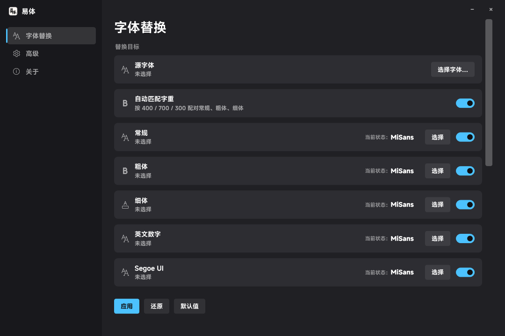

<p align="center">
  <a href="https://github.com/moyuer233/yiti"></a>
</p>

<div align="center">

# 易体 (Yiti)

_✨ 把 Windows 系统字体换成你喜欢的字体，设置、开始菜单一起变 ✨_

</div>

<p align="center">
  <a href="https://github.com/moyuer233/yiti/blob/main/LICENSE"></a>
  <a href="https://github.com/moyuer233/yiti/releases"></a>
  <a href="https://github.com/moyuer233/yiti/releases"></a>
  <a href="https://github.com/moyuer233/yiti/commits/main"></a>
  <a href="https://github.com/moyuer233/yiti/commits/main"></a>
</p>
<p align="center">
  <a href="https://www.microsoft.com/windows"></a>
  <a href="https://dotnet.microsoft.com"></a>
  <a href="https://github.com/moyuer233/yiti"></a>
</p>



## 功能

- **中文字体**：微软雅黑 常规 / 粗体 / 细体，三个字重一起换
- **英文数字**：Segoe UI、Segoe UI Variable
- **老式界面元素**：小标题栏、菜单、消息框、状态栏、图标
- **字重自动匹配**：选一个字体就够，按 400 / 700 / 300 自动配对；想单改某一行时点那行的「选择」
- **设置、开始菜单、任务栏、标题栏**：因为换的是字体文件本身，这些地方一起变
- **自动备份与回滚**：「全部回滚」一键还原；原版还能从 Windows 组件存储取回，备份丢了也能救
- **老系统自动降级**：系统里没有的字体（Win7 没有细体和 Segoe UI Variable）显示成灰色并说明原因

## 和 noMeiryoUI 有什么不同

[noMeiryoUI](https://github.com/Tatsu-syo/noMeiryoUI) 改的是「界面字体设置」（注册表 `HKCU\Control Panel`），所以它的 README 自己也列了四条做不到：任务栏、预装应用（设置、画图）、忽略系统字体的程序、以及 Windows 11 的标题栏字体。

易体换的是**字体文件本身**，这几处会一起变。三点核心差异：

| | 易体 | noMeiryoUI |
|---|---|---|
| 原理 | 替换系统字体文件（雅黑三件套 + Segoe UI） | 改界面字体设置 |
| 设置、开始菜单、任务栏、标题栏 | ✅ 一起变 | ❌ 明确不支持 |
| 字重 | 选一次自动配好常规/粗体/细体 | 要自己分别指定 |
| 回滚 | 自动备份 + 一键回滚，备份丢了还能从系统组件存储取原版 | 需要自己导出注册表 |

它做不到的我们不吹：字体渲染的清晰度（ClearType）、自带字体的应用（Office、Electron 类）、以及首次必须重启才生效，这些易体也一样没有改善。

## 怎么用

1. 点「选择字体…」挑一个字体
2. 点「应用」
3. 重启一次（字体文件要到重启时才真正换掉）

## 还原

| 入口 | 作用 |
|---|---|
| **全部回滚** | 把原版字体搬回去，并还原界面元素设置 |
| **默认值 → 应用** | 把源字体切回微软原版再写一遍 |

原版字体优先从 Windows 组件存储（`C:\Windows\WinSxS`）取，其次用第一次应用时自动做的备份。

## 风险（用之前请看完）

这个工具改的是**系统字体文件**，属于「改完必须重启、重启前不好回头」的那类操作。已知风险：

- **装错字体可能导致界面缺字**：字体汉字不全或缺对应字重时，重启后菜单、标题栏会出现方框或糊字；严重时部分老程序显示异常。程序会检查文件能否解析，但**没法替你判断字形好不好看、够不够全**。
- **影响 Office / WPS 的排版与导出**：文档里的「微软雅黑」此时已是你的字体，导出图片、打印、转 PDF 会和原来不一样（同类工具都有这个问题）。
- **首次应用必须重启**：字体在重启时才真正替换，中间强制关机可能只换了一半，需要再重启一次。
- **可能被杀软拦或误报**：要写 `C:\Windows\Fonts`，部分安全软件会拦截甚至报毒；被拦时明确报错，不静默失败。
- **系统更新可能覆盖**：Windows 大版本更新会重置系统字体，更新后要重新应用一次。
- **回滚依赖备份或组件存储**：会自动备份、也能从 WinSxS 取原版，但两者都被清理过就只剩还原点或安装介质 —— **动手前建议自己再建一个还原点**。

## 支持的系统

Windows 7 / 8 / 10 / 11。需要管理员权限（要写 `C:\Windows\Fonts`），程序自带提权声明，双击即可。

## 从源码构建

没有 Visual Studio 也能编译，只要系统自带的 .NET Framework 编译器：

```powershell
powershell -NoProfile -ExecutionPolicy Bypass -File .\build-wpf.ps1
```

产物固定在 `dist\YiTi.exe`。

## 免责

本软件按「现状」提供，不附带任何明示或暗示的担保（见 [LICENSE](LICENSE)）。因使用本软件导致的系统异常、数据丢失或其他损失，作者不承担责任。

## 许可

[MIT](LICENSE) —— 可以自由使用、修改、分发，**但必须保留作者署名与许可声明**。

## 作者

[moyuer233](https://github.com/moyuer233)