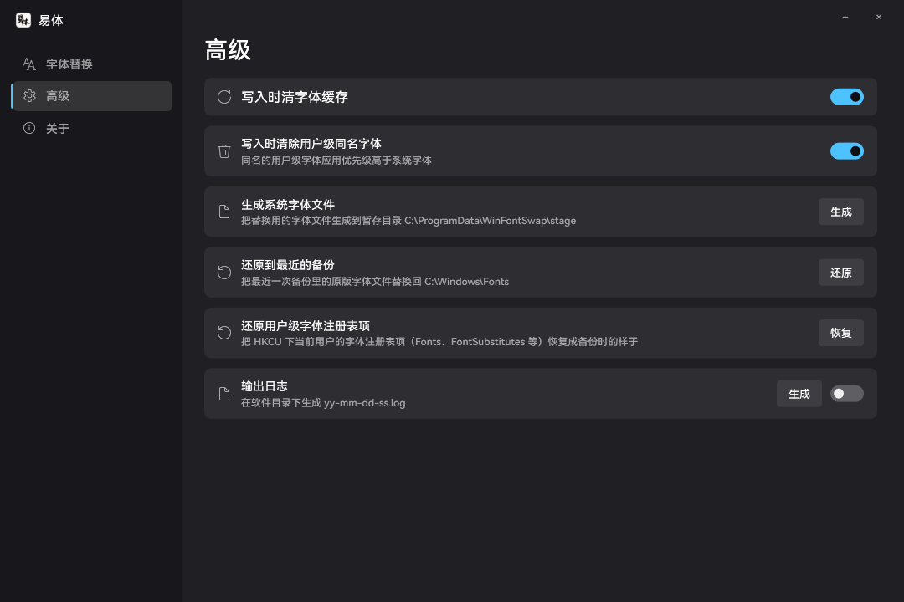
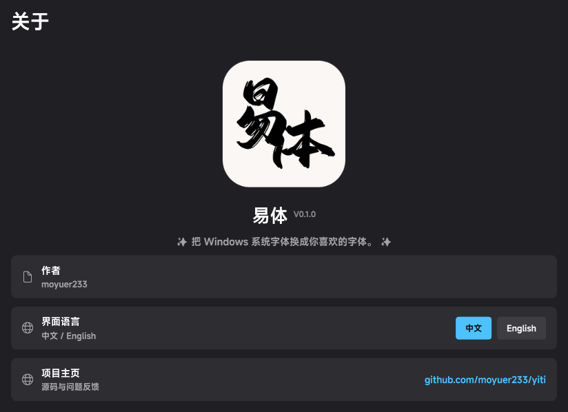

<p align="center">
  <a href="https://github.com/moyuer233/yiti"></a>
</p>

<div align="center">

# 易体 (Yiti)

_✨ 傻瓜式Windows全局字体替换工具 ✨_

<a href="README.md">中文</a> | <a href="README.en.md">English</a>

</div>

<p align="center">
  <a href="https://github.com/moyuer233/yiti/blob/main/LICENSE"></a>
  <a href="https://github.com/moyuer233/yiti/releases"></a>
  <a href="https://github.com/moyuer233/yiti/releases"></a>
  <a href="https://github.com/moyuer233/yiti/commits/main"></a>
  <a href="https://github.com/moyuer233/yiti/commits/main"></a>
</p>
<p align="center">
  <a href="https://www.microsoft.com/windows"></a>
  <a href="https://dotnet.microsoft.com"></a>
  <a href="https://github.com/moyuer233/yiti"></a>
</p>

<details>
<summary><h3>界面预览（点击展开）</h3></summary>






</details>

## 主要功能

- **系统字体替换**：设置、开始菜单、任务栏、标题栏等应用内的字体
- **界面元素字体替换**：小标题栏、菜单、消息框、状态栏、图标
- **字重自动匹配**：选中一个字体，字重按 400 / 700 / 300 自动匹配，如：微软雅黑 常规 / 粗体 / 细体，三个字重同时更换；支持自定义选择字体
- **自动备份与回滚**：「全部回滚」一键还原；默认值优先从`C:\Windows\WinSxS`获取，以便备份不存在时恢复默认值
- **自动匹配系统版本**：系统内缺失的字体（如Win7 没有细体和 Segoe UI Variable）会自动禁用
- **应用前自动创建系统还原点**：写系统前先建一个还原点，建不了会在状态栏说明原因（不阻断）
- **半替换检测**：打开时核对五个文件是否都真的换过，发现“只换了一半”就在字体页顶部提示，并给一键「重新应用」
- **备份管理**：列出每次替换前的备份（时间、体积、包含文件），「编辑模式」里可全选、批量删除，普通模式下一次只能还原一个备份；可开关自动备份、设置最多保留几份，还能看到暂存目录占用并一键清理；鼠标悬停在某次备份上可以看到那次写入了哪款字体、哪几个文件是这次真正改动过的、现在还有几个仍在用；还能从这里导入用户级字体注册（HKCU-Fonts*.reg）
- **缺失文件可补回**：启动时发现某个系统字体文件不在了（例如改名的中间步骤被打断），字体页顶部会提示，并给「从备份补回」一键还原

## 和 noMeiryoUI 有什么不同

[noMeiryoUI](https://github.com/Tatsu-syo/noMeiryoUI) 改的是「界面字体设置」（注册表 `HKCU\Control Panel`），所以它做不到：任务栏、预装应用（设置、画图）、忽略系统字体的程序、以及 Windows 11 的标题栏字体。

易体换的是**系统字体文件本身**，这几处都可以更改。两点核心差异：

| | 易体 | noMeiryoUI |
|---|---|---|
| 原理 | 替换系统字体文件（雅黑三件套 + Segoe UI） | 改界面字体设置 |
| 设置、开始菜单、任务栏、标题栏 | ✅ 一起变 | ❌ 不支持 |
| 回滚 | 自动备份 + 一键回滚，备份丢了还能从系统组件存储取原版 | 需要自己导出注册表 |

字体渲染的清晰度（ClearType）、自带字体的应用（Office、Electron 类）、以及首次必须重启才生效。

## 风险

这个工具改的是**系统字体文件**，属于「改完必须重启、重启前不好回头」的操作。已知风险如下：

- **装错字体可能导致界面缺字**：字体汉字不全或缺对应字重时，重启后菜单、标题栏会出现方框或糊字；严重时部分老程序显示异常。
- **影响 Office / WPS 的排版与导出**：文档里的「微软雅黑」此时已是你的字体，导出图片、打印、转 PDF 会和原来不一样。
- **应用必须重启**：字体在重启时才真正替换，中间强制关机可能更换不成功，需要再重启一次。
- **可能被杀软拦或误报**：要修改 `C:\Windows\Fonts`文件夹，部分安全软件会拦截甚至报毒；被拦时明确报错，不静默失败。
- **系统更新可能覆盖**：Windows 大版本更新会重置系统字体，更新后要重新应用一次。
- **回滚依赖备份或组件存储**：会自动备份、也能从 WinSxS 取原版，但两者都被清理过就只剩还原点或安装介质 —— **动手前建议自己再建一个还原点**。

## 不同系统字体修改的区别

| | Win7 | Win10 1809+ | Win11 22000+ |
|---|---|---|---|
| 雅黑 常规 / 粗体 | ✅ | ✅ | ✅ |
| 雅黑 细体（`msyhl.ttc`） | ❌ 系统没有 | ✅ | ✅ |
| 英数可变字体（`SegUIVar.ttf`） | ❌ 系统没有 | ✅ | ✅ |
| 清理用户级同名字体 | ❌ 无此机制 | ✅ | ✅ |
| 任务栏 / 设置等新界面 | 部分（靠 `segoeui.ttf`） | ✅ | ✅ |
| 可变字体（.ttf 的 VF 版）当源字体 | ❌ 只画默认字重 | ✅ | ✅ |

旧系统上「字体缓存服务」叫 `FontCache3.0.0.0`，Win10 之后是 `FontCache`。

### 实测进度

| 系统 | 状态 | 实测内容 |
| --- | --- | --- |
| Windows 11 26200 | ✅ **实测通过** | 五个字体文件替换、字重自动配对、窗口字体（菜单/消息框/状态栏/小标题栏/图标）立即生效、还原与默认值、中英双语界面、备份与回滚 |
| Windows 10 1809+ | ⚠️ **理论可用，未实测** | 按系统探测实现（用户级字体、`FontCache` 服务名、无 Mica 时用纯灰底），但没有实测 |
| Windows 7 / 8.1 | ⚠️ **理论可用，未实测** | 缺的字体自动置灰并说明原因；`FontCache3.0.0.0`、无 Mica 的分支都有实现，但没有实测 |

**需要大家的反馈。** 如果你在 Win7 / 8.1 / 10 上试过，不论成功还是失败都欢迎到 [Issues](https://github.com/moyuer233/yiti/issues) 说一声，我会根据反馈改进应用。

反馈请打开「高级」→ 打开「输出日志」开关，然后做一次操作（比如先点「生成系统字体文件」），软件目录下会生成一份 `yy-mm-dd-ss.log`，把这份日志贴上来就够了。

## 系统字体文件替换列表

| 文件 | 字体名称 | 影响范围 |
|---|---|---|
| `msyh.ttc` | 微软雅黑 常规 | 中文正文、设置、开始菜单、资源管理器 |
| `msyhbd.ttc` | 微软雅黑 粗体 | 所有加粗中文 |
| `msyhl.ttc` | 微软雅黑 细体 | 细体（Win8 起才有） |
| `SegUIVar.ttf` | Segoe UI Variable | 任务栏、设置顶部、Win11 新界面的英文数字 |
| `segoeui.ttf` | Segoe UI | 经典英文界面、老程序 |

系统字体替换流程：读取你的所选字体 → 只把字体里的名字改成 `Microsoft YaHei` / `Segoe UI` 此类 → 生成同名字体文件 → 替换系统内的 → 重启生效。只有这样系统才会识别。

窗口字体替换流程：修改注册表 `HKCU\Control Panel\Desktop\WindowMetrics`，以控制老式界面的字体和字号。

**无法更换的**：自带字体的程序（Office、Electron 应用、游戏）、网页内指定字体的文字、字体渲染参数（ClearType 类）。

### 为什么要改字体里的名字

Windows **找字体不看文件名，看字体内部的 `name` 表**（OpenType 规范里的命名表）。一个字体有 20 多个名字字段，各有编号：

| 编号 | 含义 | 系统拿它干什么 |
|---|---|---|
| 1 | 族名（Family） | 就是「微软雅黑」这四个字。GDI 的 LOGFONT、WinUI 主题里写死的字体名都指它 |
| 2 | 样式（Subfamily） | Regular / Bold / Light |
| 4 | 完整名 | 「Microsoft YaHei Bold」 |
| 6 | PostScript 名 | Adobe 系软件按它认字体 |
| 16 / 17 | 排版族名 / 排版样式 | 现代 DirectWrite 优先用这两个 |
| 3 / 18 / 21 / 22 | 唯一 ID / WWS 名 | 字体缓存与字体选单 |

易体只重写上面这 10 个字段（每条记录在 Windows 和 Mac 两种平台编码里各一份），**字形表 `glyf`、度量 `hmtx`、字符映射 `cmap`、连字 `GSUB/GPOS` 一个字节都不动**。所以换完之后：

- 界面里显示的名字还是「微软雅黑」，但**每一笔都来自你选的字体**；
- 系统按名字找字体，找到的就是这个改了名的文件，于是设置、开始菜单、任务栏都跟着变；
- 版权 / 版本 / 商标 / 设计师（0、5、7、9）**故意不改**：既保留原作者信息，也正好让程序能反查「当前装的到底是什么字体」。

## 详细原理

基本过程分「生成 → 替换 → 重启生效 」三段。

### 一、生成：把你的字体做成“同名替身”

1. 读源字体（TTC 的话按 face 索引取一个），解析表目录，只保留 TrueType 轮廓（`glyf`），CFF/OTF 直接拒绝。
2. 重建 `name` 表：把 1(族名)、2(样式)、3/4(完整名)、6(PostScript)、16/17(排版族名/样式)、18/21/22(WWS) 换成微软的名字，其他记录（版权 0、版本 5、商标 7、设计师 9…）原样保留。
3. 按目标打包：

| 目标文件 | 写进去的族名（face 数） |
|---|---|
| `msyh.ttc` | `Microsoft YaHei` + `Microsoft YaHei UI`，都是 Regular（2 个 face 的 TTC） |
| `msyhbd.ttc` | 同上两个族名，Subfamily = **Bold**，PostScript 名带 `-Bold` |
| `msyhl.ttc` | `Microsoft YaHei Light` + `Microsoft YaHei UI Light`（排版族名仍是 YaHei，排版样式 Light） |
| `SegUIVar.ttf` | `Segoe UI Variable` / `… Text` / `… Display` / `… Small` 四个族名写进同一个文件，**保留字重轴**（可变字体） |
| `segoeui.ttf` | `Segoe UI`（单 face） |

4. 重算表校验和与 `head` 的 checkSumAdjustment，拼回 TTC 目录（face 偏移按文件重排）。
5. 两道自检：① 结构校验（`Verify`：表目录、name 记录、face 数对不对）；② **真的加载一次**（GDI+ `PrivateFontCollection.AddFontFile`），系统加载不了就直接报错，不写进系统。

为什么要多 face：WinUI 组件请求的是 `Microsoft YaHei UI`，经典 GDI 请求 `Microsoft YaHei`，任务栏请求 `Segoe UI Variable Text/Display/Small` —— 一个文件名里塞不下这些族，必须做成多 face 的 TTC。

### 二、系统字体替换：备份 → 权限 → 排队改名

1. 备份原文件到 `C:\ProgramData\WinFontSwap\backup\<时间戳>\orig\`，同时把 SHA-256 写进 `state.ini`。
2. 取文件所有权、给 SYSTEM 完全控制，并**继承原字体的 DACL**（保留 UWP 需要的 `ALL APPLICATION PACKAGES` 读权限），否则改完系统应用读不到字体。
3. 新文件先落到暂存目录，然后往注册表 `PendingFileRenameOperations` 里排两对操作：
   - `暂存新文件 → C:\Windows\Fonts\msyh.ttc`
   - `C:\Windows\Fonts\msyh.ttc → 备份路径`
   字体文件被系统占用（映射在字体服务里），**只能重启时由会话管理器替换**。
4. 清字体缓存：停 `FontCache`（Win7 叫 `FontCache3.0.0.0`）、删 `FNTCACHE.DAT` 与用户 `FontCache` 目录，否则重启后仍用旧字形。
5. 记下 `applied` 清单与每个文件的新 SHA，供状态显示与回滚判断。

#### 界面元素替换

`HKCU\Control Panel\Desktop\WindowMetrics` 里 5 个值（`SmCaptionFont`、`MenuFont`、`MessageFont`、`StatusFont`、`IconFont`）是 92 字节的 `LOGFONTW`：偏移 0 是高度（负值＝字符高），偏移 `0x1C` 是 32 个宽字符的字体面名。程序直接改这两段，再回读校验。

### 三、回滚

读 `state.ini` 里的 SHA 判断当前文件是不是我们写进去的；是则把备份里的原版排进同一套重启改名队列，并把 `WindowMetrics` 恢复成备份值。原版丢失时，从 `C:\Windows\WinSxS` 里按包名（`microsoftyahei` 等）取组件存储中的原版。
### 四、当前用户已安装的字体与「写入时清除用户字体」

Windows 的字体分两层，**当前用户已安装的字体优先于系统字体**：

| 层级 | 文件位置 | 注册表 | 优先级 |
|---|---|---|---|
| 当前用户已安装（Win10 1809 起） | `%LOCALAPPDATA%\Microsoft\Windows\Fonts\` | `HKCU\SOFTWARE\Microsoft\Windows NT\CurrentVersion\Fonts` | 高 |
| 系统级 | `C:\Windows\Fonts\` | `HKLM\SOFTWARE\Microsoft\Windows NT\CurrentVersion\Fonts` | 低 |

用「为当前用户安装」装过微软雅黑的话，文件名通常是 `msyh_0.ttc` 这种。DirectWrite 会优先读这一份，所以替换 `C:\Windows\Fonts\msyh.ttc` 再重启，界面依然显示用户级那份 —— 看着像“替换成功但没变化”。

高级页的「写入时清除用户字体」默认开着，它做四件事：

1. 先把 `HKCU\...\Fonts` 整键导出到 `backup\<时间戳>\HKCU-Fonts.reg`；导出失败或文件为空就中止清理，不会“删了没备份”；
2. 只删除同时满足两个条件的注册项：值指向 `%LOCALAPPDATA%\Microsoft\Windows\Fonts\` 下的文件，且名字是雅黑 / 微软雅黑 / Segoe UI 的同名条目；
3. 只删注册项，不删字体文件，文件还留在用户字体目录里；
4. 重启后系统只认替换过的系统字体文件。

撤回用「备份管理」里的「还原用户级注册」：选那次备份 → 点按钮，导入该备份的 `HKCU-Fonts*.reg`，重新登录后用户级字体恢复原来的优先级。

没有用户级同名字体时，这个开关开与关没有区别，也不会生成 `.reg` 备份，备份管理里那个按钮就是灰的。确认本机从没“为当前用户安装”过雅黑/Segoe UI，或者故意想让自己装的那份优先，可以关掉。Windows 10 1809 之前的系统没有用户级字体机制，高级页这一行会置灰。

## 为什么「把字体文件改个名」没用

这是这个工具存在的理由。常见的三种“简单替换”都会失败：

| 做法 | 结果 |
|---|---|
| 安装一款新字体（族名不同） | 系统组件根本不会用它：WinUI 主题里写死 `Microsoft YaHei UI`，GDI 的 LOGFONT 写死 `Microsoft YaHei`，没有任何地方会按你的族名去找 |
| 把新字体文件改名成 `msyh.ttc` 覆盖 | 文件名对了，但**字体内部的族名还是原来的**（比如 HarmonyOS Sans），Windows 加载后仍按内部名注册 ⇒ 系统找 `Microsoft YaHei` 找不到，界面回退或缺字；TTC 里 face 的数量/顺序不对，还会让粗体、细体错位 |
| 只换 `msyh.ttc` 一个文件 | 粗体 `msyhbd.ttc`、细体 `msyhl.ttc` 还是雅黑，界面“半换”；Win11 的任务栏和设置顶部用的是 `SegUIVar.ttf`，不换它任务栏不变；老式菜单/消息框的字体在注册表里，不改还是雅黑 |

所以真正生效需要四件事，缺一件就会出现「设置变了、任务栏没变」这种半成品状态：

1. **改字体内部的名字**（`name` 表）：让系统认为这就是微软雅黑；
2. **五个文件一起换**：雅黑三件套 + Segoe UI 两件；
3. **写注册表** `HKCU\Control Panel\Desktop\WindowMetrics`：老式界面元素（菜单、消息框、状态栏、图标）；
4. **清字体缓存 + 重启时替换**：字体文件被系统占用，不能热替换；缓存不清会继续用旧字形。

## 从源码构建

需要`.NET Framework`编译器：

```powershell
powershell -NoProfile -ExecutionPolicy Bypass -File .\build-wpf.ps1
```

产物固定在 `dist\YiTi.exe`。

### 改界面文案

界面文字全部在 `lang/zh.toml` 与 `lang/en.toml`，TOML 格式：`[分节]` 表示界面位置，下面是 `"键 = 值"`：

```toml
[font]
"apply" = "应用"
"auto.weight.matching" = "自动匹配字重"

[adv]
"generate.only" = "生成用于替换的字体"
"write.a.log" = "输出日志"
```

**只改引号里的文字，左边的 key 不要动**——代码按「分节.键」取字，改了 key 就会退回显示 key 本身。中文写引号里可以带空格、逗号、冒号；要写双引号就写 `\"`。改完重新跑 `build-wpf.ps1`，文案会编译进 exe。

## 鸣谢

- [noMeiryoUI](https://github.com/Tatsu-syo/noMeiryoUI)（Tatsuhiko Syoji）：窗口字体（非客户区字体）的修改思路来自它。本项目没有复用它的代码，只沿用了同一套做法：改 `WindowMetrics` 里的 LOGFONT，再用 `SystemParametersInfo` 让改动立即生效。
## 免责

本软件已明确说明修改风险，因使用本软件导致的系统异常、数据丢失或其他损失，程序作者不承担相关责任。

## 许可

[MIT](LICENSE) —— 可以自由使用、修改、分发，**但必须保留作者署名与许可声明**。
